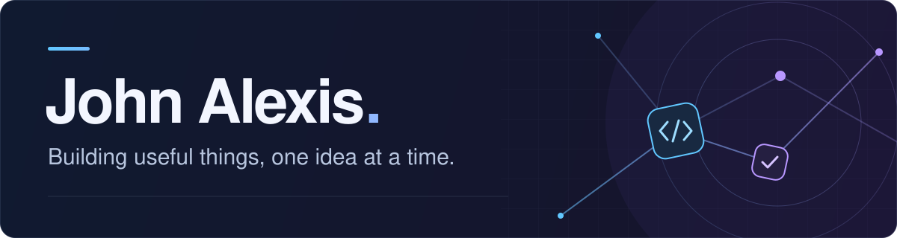

  

  <h3>Computer Science student · Software Developer / AI Engineer</h3>

  
Based in the Philippines. Learning full-stack development. Building apps for better planning, focus, and everyday progress.

  

    <a href="#selected-projects">Explore my projects</a> &nbsp; / &nbsp;
    <a href="#my-toolkit">My toolkit</a> &nbsp; / &nbsp;
    <a href="https://github.com/Johnkoder?tab=repositories">All repositories</a>
  

## Selected projects

I turn personal ideas into apps, from product decisions and interface design to testing and releases. I use AI coding tools throughout implementation and keep learning through each iteration.

<table>
  <tr>
    <td width="50%" valign="top">
      <h3>📅 Smalendar</h3>
      
ANDROID · PUBLIC BETA

      
A local-first calendar that turns everyday requests into AI-assisted event and reminder drafts for you to review.

      
<a href="https://github.com/Johnkoder/smalendar-official">Explore project →</a>

    </td>
    <td width="50%" valign="top">
      <h3>💡 IdeaHub</h3>
      
WINDOWS · DESKTOP WORKSPACE

      
A home for ideas, notes, visual canvases, and tasks. Built around a local workspace for personal organization.

      
<a href="https://github.com/Johnkoder/idea-hub-official">Explore project →</a>

    </td>
  </tr>
  <tr>
    <td width="50%" valign="top">
      <h3>🏋️ RankFit</h3>
      
ANDROID · FITNESS &amp; PROGRESSION

      
A workout timer with routines, XP, ranks, and streaks. Train offline and control your workout with voice commands.

      
<a href="https://github.com/Johnkoder/rankfit-official">Explore project →</a>

    </td>
    <td width="50%" valign="top">
      <h3>📚 BookRank</h3>
      
ANDROID · READING &amp; PROGRESSION

      
An offline PDF reading tracker with bookmarks, reading statistics, ranks, and achievements to track your progress.

      
<a href="https://github.com/Johnkoder/book-rank-official">Explore project →</a>

    </td>
  </tr>
  <tr>
    <td width="50%" valign="top">
      <h3>⏱️ Lock In</h3>
      
ANDROID · FOCUS &amp; PRODUCTIVITY

      
A cozy Pomodoro app with focus sessions, activity tracking, and a Timelapse Studio. Keep your progress locally.

      
<a href="https://github.com/Johnkoder/lock-in-official">Explore project →</a>

    </td>
    <td width="50%" valign="top">
      <h3>✅ HabitRank</h3>
      
ANDROID · IN DEVELOPMENT

      
A habit tracker that turns everyday consistency into XP, streaks, ranks, achievements, and seasonal progression.

      
<a href="https://github.com/Johnkoder/habit-rank-official">Explore project →</a>

    </td>
  </tr>
</table>

These project pages contain app information and available releases. Application source code is not published in every repository.

## My toolkit

| Area | Technologies |
| :--- | :--- |
| Web | JavaScript · React · HTML · CSS |
| Backend | Node.js · Express · MongoDB |
| Mobile | Flutter · Dart |
| Programming | Python |
| Tools | Git · GitHub · Docker · Vercel |

## What I'm working toward

- **Full-stack development:** strengthening how I connect interfaces, APIs, and data.
- **Useful AI features:** helping people plan and organize with reviewable AI suggestions.
- **Better apps:** refining the design, testing, and release process with every project.

---

Idea → Design → Build → Test → Release → Improve

